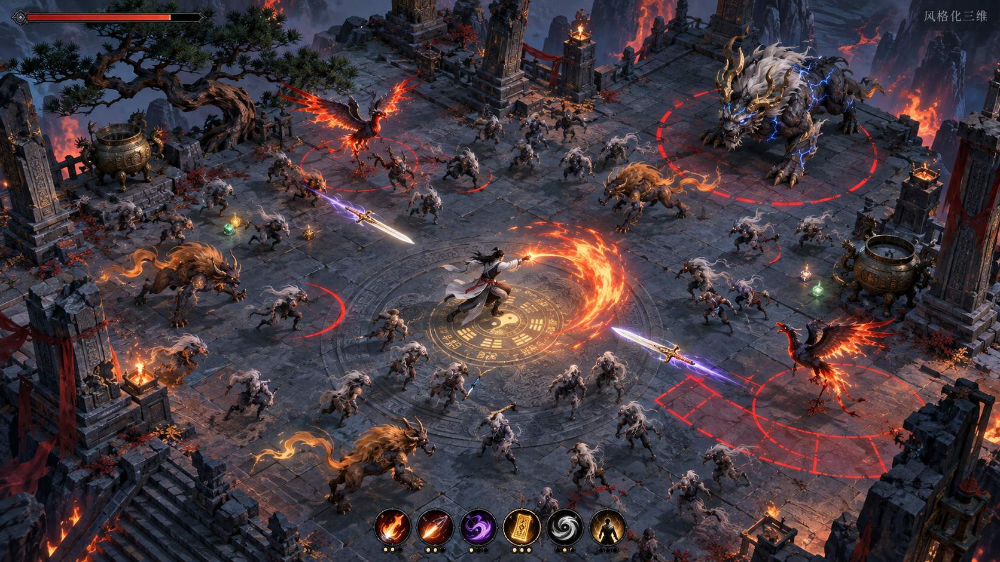
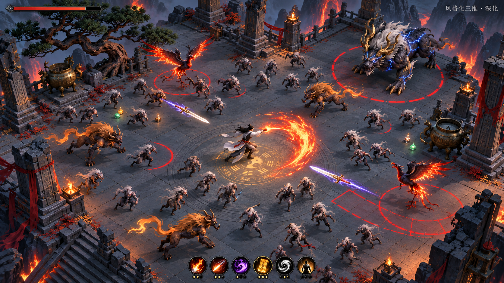

# 道衍万象 项目交接

更新：2026-10-30。本文记录已核查事实、未决事项及最小下一步，不代表新的统一设计规范。

## 1. 接手目标与授权边界

原对话最后未完成的请求是“给我一份交接文档，让下一个 agent 可以独立接手继续”。用户随后要求安装 UE 官方相关 AI 工具，并明确“在 dot 里面操作安装”。

- 当前目标项目是 [roojay/dywx-survivors](https://github.com/roojay/dywx-survivors)，不要误用此前 `rift-survivors` 的玩法、资产或部署记录。
- 工具安装限定 dot 环境。此前 Rift 上传任务的临时 Windows / WSL 授权不适用于本项目。
- 本交接文件已随第四张风格化三维原图及深化图一同归档；仓库既有设计原稿保持不变。

## 2. 已确认的方向

用户倾向 **UE5、风格化 3D、由 AI 承担实现**，不喜欢像素风的视觉负担。先使用社区现成、已绑定并带动画的模型占位，跑通玩法后再完善资产；素材仍须核对许可证、来源和可再分发条件。

视觉以原对话第四张为首选：**《Daoist Survivor Battles Mountain Spirits.png》**，图内标注“风格化三维”。它是斜俯视深蓝灰神庙石台、白衣修士、具有体积感的敌群与巨兽、金橙火焰、紫色飞剑及红圈预警，不是写实风或随意替换的低多边形卡通。第一张 **《Daoist Battle in the Spirit Courtyard.png》** 标注“暗夜像素”，用户曾表示喜欢，但随后明确不喜欢像素画面的观看负担；不据此重新选择像素制作路线。本次仅归档第四张及其深化原图，不归档第一张像素参考；保留原始 PNG 字节，未重新生成替代。

- [第四张：风格化三维原图](art/style-04-stylized-3d.png)
- [风格化三维深化原图](art/style-04-stylized-3d-refined.png)
- [图片来源与完整性说明](art/README.md)

以上是 AI 生成的概念美术参考，不是已实现游戏截图、UE 场景或性能验证证明。

世界观保留 **“神话为表，科技为里；探索为引，认知为赏”**。玩家可见命名、美术和叙事应先呈现东方神话／仙侠，底层科技作为逐步发现的解释，不直接改成科幻包装。

## 3. 仓库事实与阅读顺序

核查时 `main` HEAD：`5a64e2d1256b46108730725690a81d896290d658`，提交标题 `docs: archive gameplay and MVP configuration v0.1`。该提交归档三份文件；并非可运行 UE 版本证明。

从固定提交的 [docs/README.md](https://github.com/roojay/dywx-survivors/blob/5a64e2d1256b46108730725690a81d896290d658/docs/README.md) 进入。索引明确说明文档有版本差异，尚未合并为统一实现规范。

| 文档 | 含义 |
|---|---|
| `docs/game-design.md` | 早期总体设计，路线 A |
| `docs/first-playable-prototype.md` | 路线 A 的首个可玩切片 |
| `docs/gameplay-design-v0.1.md` | 后续玩法稿，路线 B |
| `docs/mvp-prototype-config-v0.1.md` | 路线 B 的参数与测试配置 |

上述路径均以此固定提交为证据基线；后续接手先检查远端是否变化。本次补图前已核查该提交的完整 Git 树，仅含五份 Markdown 文档，没有实现代码或美术图片；此判断仅适用于该固定提交。玩法稿中的核心循环图只剩文本说明，导出的实际图形缺失，不能当作已恢复。

## 4. 两套玩法不能直接拼接

| 决策项 | 路线 A | 路线 B |
|---|---|---|
| 首测范围 | 1 角色、3 技能、2 遗珍、3 波，约 3–5 分钟 | 1 洞天、2 修士、10 术法、5 心法、2 破境、15 法宝；比较 4／6 波 |
| 成长 | 波内悟法、波间安全选择；技能 5 级觉醒 | 修为满后顿悟；术法升级、心法及双技能融合破境 |
| 物品 | 遗珍即时生效、同名叠加；无背包换装 | 6 装备位、随机灵纹、背包、波间换装和炼化 |
| 联动 | 两个不同合格技能自动形成道象 | 元素／形态双轴 2／4 阈值，融合保留计数 |
| 局外 | 图鉴、外观、内容解锁；不加永久属性 | 建议永久属性不超过 10%，后续考虑本命法宝 |

两者共同保留自动攻击、走位／遁术、清晰预警及成长反馈；首版均不应带出已装备战力。**上传时间更晚不等于用户已选择路线 B。** A 明确排除的背包、随机词缀、六装备位，不能静默混入 A；融合、道象和双轴共鸣也不能同时堆入首版。

必要决策：请用户选择首个可玩版本以 A 或 B 为基线。确认前可验证技术管线，不把任何一套复杂规则编码成默认事实。若选择 A，现成切片是断岳行者、断岳三叠／回风刃环／穿云重矢、磨砺石／须弥镜、追击普通怪与预警冲锋精英、三波及两次波间选择。

所有数值仍是设计提案，未经实测。尤其路线 B 的 Boss 生命／DPS、4／6 波节奏、掉落数量、技能成长选择数、终局奖励用途，以及升级暂停、触发递归、融合成本和计数边界，都须在选定基线后收敛，不可宣传为已平衡。

## 5. UE 官方工具：已核实与未验证

官方来源确认存在：

- [UE 5.8 发布说明](https://www.unrealengine.com/news/unreal-engine-5-8-is-now-available)：包含实验性 UnrealMCP。
- [UnrealMCP 文档](https://dev.epicgames.com/documentation/unreal-engine/unreal-mcp-in-unreal-editor)：通过运行中的编辑器提供工具；调用串行执行。默认本地 HTTP 无认证，不得暴露公网。
- [Epic 官方 skills 仓库](https://github.com/EpicGames/unreal-engine-skills-for-claude-code-plugin)：技能、工作流与 hooks，不是 UE 引擎安装包，也不是独立 MCP 服务；客户端兼容性须实测。
- [ushell](https://dev.epicgames.com/documentation/en-us/unreal-engine/how-to-use-ushell-for-unreal-engine)：构建、烹饪、暂存、运行命令行工作流，不是万能编辑器控制接口；打包还可用 [UAT BuildCookRun](https://dev.epicgames.com/documentation/unreal-engine/packaging-your-project)。

**安装状态：尚未完成可用安装。** dot 为 Linux，约 30 GiB 空闲；有限目录检查未发现 UE。当前环境的技能安装目录只读，官方安装流程未能完成；未注册全局技能、未启用 MCP。当前仅在工作区暂存并校验 Epic 官方插件 `3.1.2`、提交 `0e27bde2b55c5d3f6948532f4296aaa3654d8f4b`，包含 `unreal-mcp`、`create-toolset`、`unreal-skill` 三个技能；已通过 12 个原版文件的 SHA256 校验、JSON 解析、hook 静态语法检查及 Git 对象校验；没有执行 hook。引擎版本、工具链、客户端连接、编辑器启动、构建和打包均未验证。文件就绪不等于安装、加载或运行成功；不得转到其他机器绕过 dot 限定。

### Blender 官方工具状态

在 dot 内已独立安装 Blender 5.2.3 与官方 MCP add-on / CLI 1.0.3；本机只读连通测试完成（初始化、26 项工具列表、版本及默认对象查询）。测试服务只监听 `127.0.0.1:9876`，现已关闭且关闭自动启动；未注册为 dot 全局原生工具，尚未验证建模操作。此结果不代表 UE 工具安装完成。

## 6. 下一步及验收

1. 汇总 dot 安装结果：记录官方来源、固定版本／提交、实际安装位置、加载验证和剩余阻塞；不申请或复用其他机器权限。
2. 确认 dot 是否具备目标 UE 编辑器、磁盘、图形环境和编译链；需要账户登录、许可接受或扩大安装范围时单独交回用户处理。
3. 仅做最小 UE 自动化技术试样：小地图、一个现成绑定角色、一种敌人、一种法术，实现移动、自动攻击、受击、死亡、重开。先验证资产导入、编辑器操作、编译和打包链路，不先搭大型框架或完整内容库。
4. 保留编译日志、实际运行截图／视频、规则检查和打包日志，并启动独立包验证。编辑器截图不能替代独立包启动证据；工具列表不能替代成功调用证据。
5. 用户选定玩法基线后，再冻结首测规则和验收清单。性能测试注明硬件、分辨率和帧时间；约 130 个同屏敌人是后续压力目标，不是 130 种敌人，更不是已达到的指标。

交接时明确区分：**文档与第四张及其深化原图已归档、官方工具已核实存在；统一玩法未选定，官方技能源文件已就绪但激活安装受阻，UE 运行／自动化／游戏可玩性均未验证。**
